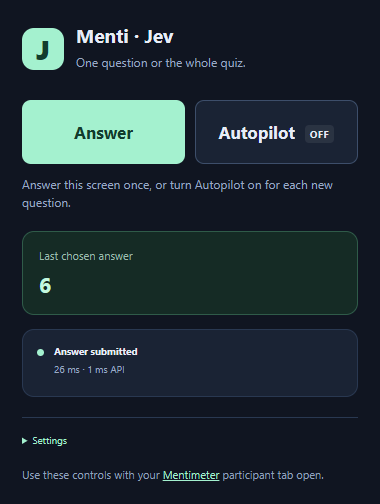

# Menti · Jev 1.14

A Chrome/Edge extension that detects visible Mentimeter quiz questions, asks Jev which option is correct, and clicks the answer. It presses Submit when a separate submit button appears.



## Install

Download `menti-jev-extension-1.0.2.zip` from the [latest release](https://github.com/YoYo-XYZ/menti-jev/releases/latest) and extract it, or clone this repository and use its `extension` folder.

1. Open Chrome's Extensions page or Edge's Manage Extensions page.
2. Enable **Developer mode**, choose **Load unpacked**, and select this project's `extension` folder. If you downloaded the ZIP, extract it and select the folder containing `manifest.json`.
3. Pin **Menti · Jev 1.14** to your toolbar, open its popup, and expand **Settings**.
4. Choose **OpenRouter** or **TypeSafe** under **API provider**, and enter an API key issued by that provider. OpenRouter keys are available in [OpenRouter settings](https://openrouter.ai/settings/keys); direct TypeSafe keys come from the [TypeSafe console](https://console.typesafe.ai). Click **Save settings**.
5. Join your quiz at [menti.com](https://www.menti.com), enter your participant name manually, and keep the participant tab visible. Open the extension and press **Answer** for the current screen, or **Autopilot** to answer new questions automatically. Refresh a Mentimeter tab that was already open when you installed the extension.

## Controls

- **Answer** answers and submits the current question once, including when Autopilot is off. It also retries a failed request for the same question. If the question changes before the result arrives, the extension discards that result. A manual request does not answer the next question.
- **Autopilot** toggles automatic answering on or off immediately. Click again to stop; no Save step is needed. Turning it off cancels pending decisions.
- **Last chosen answer** shows only the most recent answer that the extension selected. It stays visible while waiting for the next question and is replaced when the extension chooses the next answer. Closing and reopening the popup preserves this display for the participant tab. It resets when that tab's content reloads or the extension restarts.

Fresh installations start with Autopilot off. Existing installations retain their automatic-answering setting. Settings are collapsed during normal use; API configuration is under **Settings**, and detection overrides and answer-bank entries are under **Settings → Advanced settings**.

Version 1.0.2 adds the Answer and Autopilot controls and the latest-answer display. To update an existing installation, replace the extension files and reload it on the browser's Extensions page. If you extracted to a different folder, remove the old extension and load the new folder. Refresh the Mentimeter tab. OpenRouter remains supported; select it under **Settings** if you use an OpenRouter key.

**HTTP 401:** the selected provider rejected the key. Confirm that the provider matches the service that issued the key. The original 1.0.0 extension only called TypeSafe, so OpenRouter keys could not work with it. Paste only the key; version 1.0.1 also accepts a pasted `Bearer` prefix. A 401 is not resolved by changing the quiz selectors or increasing the deadline.

## Speed

- A `MutationObserver` detects page changes, with an 8 ms settling window. Set this to `0` in **Settings → Advanced settings** for the shortest scheduled detection delay. Rendering, browser scheduling, and background-tab throttling still apply.
- Each new multiple-choice question uses one HTTPS call to the selected provider. There is no local server, OCR, screenshot capture, agent planning loop, or intermediary model.
- Direct TypeSafe requests use `jev-1.14.0`; OpenRouter requests use `typesafe/jev-1.14`. OpenRouter's dated Jev 1.14 response identifiers are accepted.
- The extension can start inference while visible choices are disabled during a countdown. It retains the decision until those choices unlock, provided the question stays the same.
- Identical questions with identical option order reuse up to 128 answers in service-worker memory. Changed option order triggers a new inference. Browser suspension or a restart can clear this cache.
- Exact answer-bank matches skip the API call entirely.
- A 500 ms fallback check catches changes missed by the observer. Normal detection uses the observer.

The popup shows the last answer, confidence, API duration, and duration from detection to action. These durations exclude time before the extension detects the question. For a separate submit button, the last action duration updates when that button is clicked. It does not measure server receipt or grading.

Default minimum confidence is `0`, which always uses Jev's valid selected answer. Increase it to skip uncertain choices. The default API deadline is 2,500 ms. Expired requests and rate limits stop until the next question or **Answer**, avoiding repeated requests for the same question.

## Supported questions

**Select Answer:** text questions with two or more readable choices and a single answer selection. Jev chooses one supplied option. A question can still be answered incorrectly.

**Type Answer:** supply exact question-to-answer pairs in **Settings → Advanced settings**, for example:

```json
{
  "What is 2 + 2?": "4",
  "What is the capital of France?": "Paris"
}
```

Whitespace is normalized; matching remains case-sensitive. Bank entries also work for multiple-choice questions when the answer matches an option. Unknown typed questions stay unanswered because Jev selects from predefined outputs and does not generate free text. Image-only questions, checkbox/multiple-selection polls, and questions displayed only on the presenter's screen are not supported.

## If automatic detection misses a question

Mentimeter can change its page structure. Detection currently uses question headings, explicit answer markers, radio controls, and groups of sibling answer buttons. It has been tested on simulated participant pages, not a live hosted Mentimeter quiz.

In **Settings → Advanced settings**, you can set CSS selectors for the question, answer options, typed-answer input, and submit button. Each option selector must match one clickable element per answer, in displayed order. The question selector must identify the question text alone. Leave unused overrides blank. Save, then use **Answer**.

If detection identifies the wrong heading, an explicit question selector is the best correction. Without question/slide identifiers in the page, the extension distinguishes questions by URL, question text, and options. Identical consecutive questions need a detectable transition or **Answer**.

## Data and credentials

The API key is stored in the browser profile's extension storage and is accessible to the extension popup and service worker. Content scripts receive settings with the key removed; storage access is restricted to trusted extension contexts. The key is not encrypted by this project. Avoid a shared browser profile.

Requests go to the selected provider only: `https://api.typesafe.ai/v1/systemone` for TypeSafe, or `https://openrouter.ai/api/alpha/decisions` for OpenRouter. They contain the detected question and answer options, with the key in the authorization header, and omit browser cookies. No fallback sends your key to the other provider. The extension does not read presenter answer keys, private quiz APIs, or other participants' responses. API use is billed by the selected service. Extension access is limited to these two API hosts and the participant hosts, `menti.com` and `www.menti.com`.

## Verification

Development requires Node.js 22 or newer. Installation in the browser does not require Node.js or a build step.

```powershell
npm ci
npx playwright install chromium
npm test
```

The suite loads the real extension into Chromium and uses simulated participant pages with mocked provider APIs. It checks selection/submission, stale answers, pausing, countdown unlocking, response validation, confidence thresholds, rate limits, caching, typed answers, selector fallbacks, timeouts, retry, popup settings, OpenRouter routing and model identifiers, and provider-specific authentication errors. It makes no paid API calls.

A real API key for your selected provider and an active Mentimeter quiz are still needed to verify live accuracy, page compatibility, and network latency. No live latency or accuracy claim has been established.

## API references

- [Jev 1.14 release](https://typesafe.ai/blog/jev-1-14)
- [TypeSafe System One API](https://docs.typesafe.ai/api/system-one)
- [Choice request and response contract](https://docs.typesafe.ai/primitives/choice)
- [OpenRouter Jev API examples](https://openrouter.ai/blog/insights/what-is-jev/)
- [Mentimeter Select Answer behavior](https://help.mentimeter.com/en/articles/2968106-select-answer-quiz-competition-slide)
